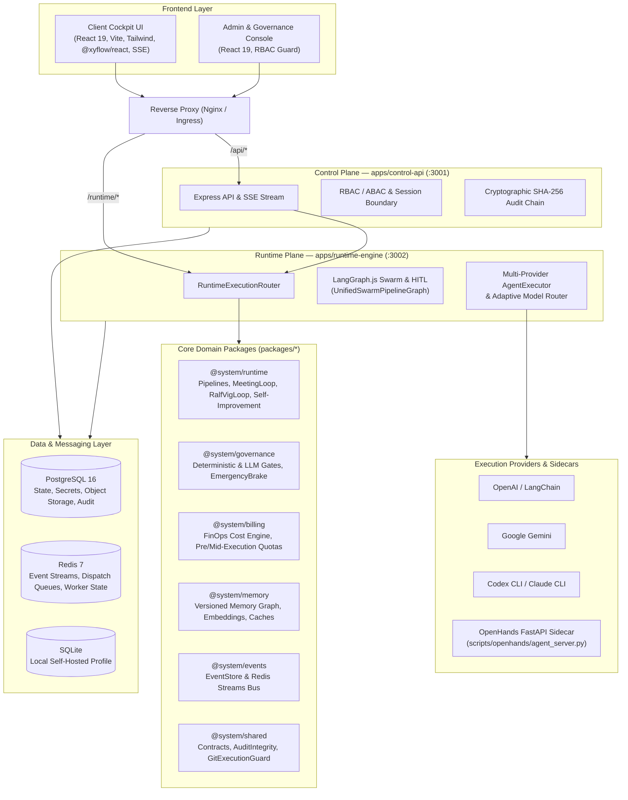

# Agents-System — Multi-Agent Orchestration Platform, Control Plane & Governed Runtime

**Agents-System** is a modular TypeScript/Node.js + Python monorepo implementing a production-oriented **Multi-Agent Control Plane & Runtime Platform**. It decouples orchestration, governance, FinOps cost controls, and stateful memory from underlying LLM and coding-agent execution providers.

> **Why this architecture exists:** Most agentic demos collapse under real production constraints—silent schema drops, runaway token loops, cross-workspace state pollution, and brittle coupling to a single model vendor. `agent-system` solves these with a strict Control Plane / Runtime Plane split, deterministic + LLM governance gates, multi-provider failover, versioned graph memory, and real-time cost/quota enforcement.

---

## System Architecture



---

## Key Engineering Capabilities & Code Map

### 1. LangGraph Swarm, Declarative Pipelines & Consensus Loops (`packages/runtime`)
- **Stateful Multi-Agent Orchestration:** Built on `@langchain/langgraph` (`StateGraph`, `Annotation.Root`, `MemorySaver`, `interrupt`, and `Command` for Human-in-the-Loop approvals) coordinating **16 specialized agent roles** across **13 lifecycle pipelines** (`unified-task-intake`, `new-feature`, `bug-fix`, `refactor`, `sprint-integration`, etc.) — [`UnifiedSwarmPipelineGraph.ts`](packages/runtime/src/graphs/UnifiedSwarmPipelineGraph.ts).
- **Declarative Pipeline Executor & DAG Planner:** Topological stage ordering with `hard` and `soft` policy gates — [`DynamicPipelineExecutor.ts`](packages/runtime/src/DynamicPipelineExecutor.ts), [`DependencyGraphPlanner.ts`](packages/runtime/src/DependencyGraphPlanner.ts).
- **Autonomous Execution & Multi-Agent Consensus:**
  - `RalfVigLoop` + `GovernanceLoopEngine`: autonomous `pending -> in_progress -> verifying -> done/blocked` state machine with bounded retries and postflight evidence verification — [`RalfVigLoop.ts`](packages/runtime/src/pm/engine/RalfVigLoop.ts).
  - `MeetingLoopRuntime`: structured multi-agent rounds with `RoundEngine`, `TurnEngine`, `ModeratorEngine`, and `ArtifactValidationEngine` — [`MeetingLoopRuntime.ts`](packages/runtime/src/meeting/MeetingLoopRuntime.ts).

### 2. Multi-Provider Execution & Adaptive Model Routing
- **Provider Failover Chain:** `AgentExecutor` unifies `CodexCliAdapter`, `ClaudeCliAdapter`, `OpenHandsAdapter`, `GeminiAdapter`, and `LangChainAdapter` behind a single `ExecutionAdapter` contract with automatic fallback — [`AgentExecutor.ts`](packages/runtime/src/AgentExecutor.ts).
- **Adaptive Tier Routing:** `AdaptiveIntelligenceEngine` classifies task complexity (`classification`, `bugfix`, `refactor`, `research`, `design`) and dynamically selects `cheap` (`gpt-4o-mini`), `medium` (`gpt-4o`), or `expensive` (`gpt-4.1` / Claude) tiers respecting plan caps and budget pressure — [`AdaptiveIntelligenceEngine.ts`](packages/runtime/src/adaptive/AdaptiveIntelligenceEngine.ts).
- **Python FastAPI + Pydantic Sidecar:** Non-blocking REST sidecar for OpenHands sandbox runs across OpenAI, Anthropic, and Google providers — [`scripts/openhands/agent_server.py`](scripts/openhands/agent_server.py).

### 3. Deterministic + LLM Governance Engine (`packages/governance`)
- **Pre/Post-Execution Policy Gates:** Pluggable evaluator registry covering `preflight_token` (git worktree isolation), `ticket_context_present`, `postflight_report`, `cost_guard_tokens`, `loop_pressure_hard`, and `LlmVerifierWrapper` — [`DeterministicEvaluationEngine.ts`](packages/governance/src/DeterministicEvaluationEngine.ts), [`LlmVerifierWrapper.ts`](packages/governance/src/LlmVerifierWrapper.ts).
- **Schema Repair & Incident RCA:** `ResponseContractGuard` validates agent response structure and builds targeted reprompt instructions on mismatch; `AutoRcaEngine` performs automated root-cause diagnostics — [`ResponseContractGuard.ts`](packages/runtime/src/ResponseContractGuard.ts), [`AutoRcaEngine.ts`](packages/runtime/src/AutoRcaEngine.ts).

### 4. AI FinOps, Quotas & Cost Guardrails (`packages/billing`)
- **Real-Time Cost Attribution:** Aggregates tokens, tool calls, and runtime seconds into monetary cost (`USD`) attributed per agent and pipeline stage — [`CostOptimizationEngine.ts`](packages/billing/src/CostOptimizationEngine.ts).
- **Proactive & Mid-Run Enforcement:** `PreExecutionQuotaEnforcer` blocks over-quota runs upfront; `MidExecutionQuotaController` triggers soft quality/model degradation or hard stops mid-flight, paired with `AntiAbuseGuard` — [`PreExecutionQuotaEnforcer.ts`](packages/billing/src/PreExecutionQuotaEnforcer.ts), [`MidExecutionQuotaController.ts`](packages/billing/src/MidExecutionQuotaController.ts).

### 5. Versioned Shared Memory Graph & Multi-Tier Caching (`packages/memory`, `packages/runtime`)
- **Workspace-Isolated Memory Graph:** Stores versioned entities (`idea`, `decision`, `artifact`, `task`, `message`) and typed relations (`depends_on`, `relates_to`, `contradicts`, `refines`) with `MemoryPromotionEngine` across tiers — [`SharedMemoryGraphModel.ts`](packages/memory/src/runtime-memory/SharedMemoryGraphModel.ts), [`MemoryPromotionEngine.ts`](packages/memory/src/runtime-memory/MemoryPromotionEngine.ts).
- **Embeddings & Optimization Layers:** OpenAI vector embeddings (`text-embedding-3-small`) via [`SemanticEmbeddingProvider.ts`](packages/memory/src/runtime-memory/SemanticEmbeddingProvider.ts), Jaccard similarity `SemanticCache`, `LlmResponseCache`, `ToolResultCache`, `StepDedupEngine`, and `ChainPruningEngine`.

### 6. Self-Improvement Loop & Learning KPI
- Extracts post-run telemetry signals (`compliance_issue`, `cost_issue`, `throughput_bottleneck`), drafts structured improvement proposals/tickets, and validates improvement regressions via `evaluateLearningTrendKpi` — [`ImprovementEngine.ts`](packages/runtime/src/improvement/ImprovementEngine.ts).

### 7. Enterprise Security, Frontend Cockpit & SRE Infrastructure
- **Tamper-Evident Audit Chain:** SHA-256 hash chaining (`prevHash + canonicalized payload -> hash`) verifies audit log integrity — [`AuditIntegrity.ts`](packages/shared/src/AuditIntegrity.ts).
- **RBAC + ABAC Access Control:** Attribute-based policy enforcement across tenants/workspaces (`AbacPolicyEngine.ts`) and encrypted PostgreSQL secrets storage (`cockpit_secrets_pg`).
- **Dual Frontend Apps:** Cockpit workspace (`React 19`, `@xyflow/react`, `dagre`, `Zustand`, `Radix UI`, `SSE`) in `apps/client-app` and isolated admin governance console in `apps/admin-app`.
- **Cloud-Ready Deployment:** Dockerfiles, Compose stack (`infra/compose/runtime.yml`), Nginx reverse-proxy template (`infra/proxy/nginx.reference.conf`), Kubernetes Kustomize baseline (`infra/k8s/base` with `StatefulSet`, `HPA`, `PDB`, `Ingress`), and GitHub Actions CI gates.

---

## Monorepo Layout

| Path | Responsibility |
| :--- | :--- |
| `apps/control-api` | Control Plane REST API, RBAC/ABAC auth boundary, billing/telemetry routes, SSE event streaming |
| `apps/runtime-engine` | Standalone Runtime Plane execution service (`/health`, `/ready`, `/api/runtime/status`, `/api/runtime/execute`) |
| `apps/client-app` | React 19 + Tailwind + React Flow user cockpit for run monitoring, graph visualization, and chat/HITL |
| `apps/admin-app` | Dedicated React 19 admin & governance operations console |
| `packages/runtime` | LangGraph swarm, pipeline executors, multi-provider adapters, adaptive routing, caching, self-improvement |
| `packages/governance` | Deterministic and LLM evaluators, preflight/postflight gates, emergency brake, intake classifier |
| `packages/billing` | Token/tool/runtime cost accounting, entitlements, pre/mid-execution quota controllers, anti-abuse |
| `packages/memory` | Shared memory graph, embeddings provider, Postgres auth/secrets/object stores, environment provisioning |
| `packages/events` | Event bus, validation, and run-ledger event persistence |
| `packages/shared` | Shared domain types, cryptographic SHA-256 audit chain, git execution guards |
| `db/migrations` | PostgreSQL schema migrations (`platform/0001_cockpit_postgres_init.sql`) |
| `infra` | Docker Compose (`compose/runtime.yml`), Kubernetes Kustomize (`k8s/base`), Nginx proxy config |
| `scripts` | CI gates, smoke suites, chaos drills, Python OpenHands FastAPI sidecar (`scripts/openhands/agent_server.py`) |
| `docs` | Architecture specs, runtime contracts, SLO definitions, and sprint verification reports |

---

## Quick Start & Verification

### Prerequisites
- Node.js 20+ (and npm workspaces)
- Docker & Docker Compose (for PostgreSQL 16 & Redis 7 in distributed mode)
- Python 3.10+ (optional, for the OpenHands FastAPI sidecar)

### 1. Configure Environment & Build Monorepo
```bash
cp .env.example .env
npm install
npx tsc -b tsconfig.build.json
```

### 2. Run Local Services or Docker Compose Stack
```bash
# Start PostgreSQL, Redis, Control API (:3001), and Runtime Engine (:3002)
docker compose -f infra/compose/runtime.yml up --build

# Or run individual dev workspaces locally
npm run dev:control
npm run dev:runtime
npm run dev:client
npm run dev:admin
```

### 3. Run Architecture, CI Hardening & Unit Tests
```bash
# TypeScript project-references build
npx tsc -b --force tsconfig.build.json

# CI hardening & infrastructure gates (config, frontend boundary, K8s manifests, smoke mocks)
npm run infra:ci:config-gate
npm run infra:ci:frontend-split-gate
npm run infra:k8s:validate
npm run infra:smoke:suite:mocks   # note: proxy_path check requires a running Docker daemon

# Core runtime, memory, governance & FinOps unit suites (packages/runtime/src/__tests__)
npx jest --runInBand \
  packages/runtime/src/__tests__/dynamic_pipeline_executor.test.ts \
  packages/runtime/src/__tests__/planner_engine.test.ts \
  packages/runtime/src/__tests__/semantic_cache.test.ts \
  packages/runtime/src/__tests__/step_dedup_engine.test.ts \
  packages/runtime/src/__tests__/llm_response_cache.test.ts \
  packages/runtime/src/__tests__/chain_pruning_engine.test.ts \
  packages/runtime/src/__tests__/smart_retry_policy.test.ts \
  packages/runtime/src/__tests__/meeting_loop_runtime.test.ts \
  packages/runtime/src/__tests__/round_engine.test.ts \
  packages/runtime/src/__tests__/artifact_validation_engine.test.ts \
  packages/runtime/src/__tests__/agent_identity_model.test.ts
```

---

## License

ISC
