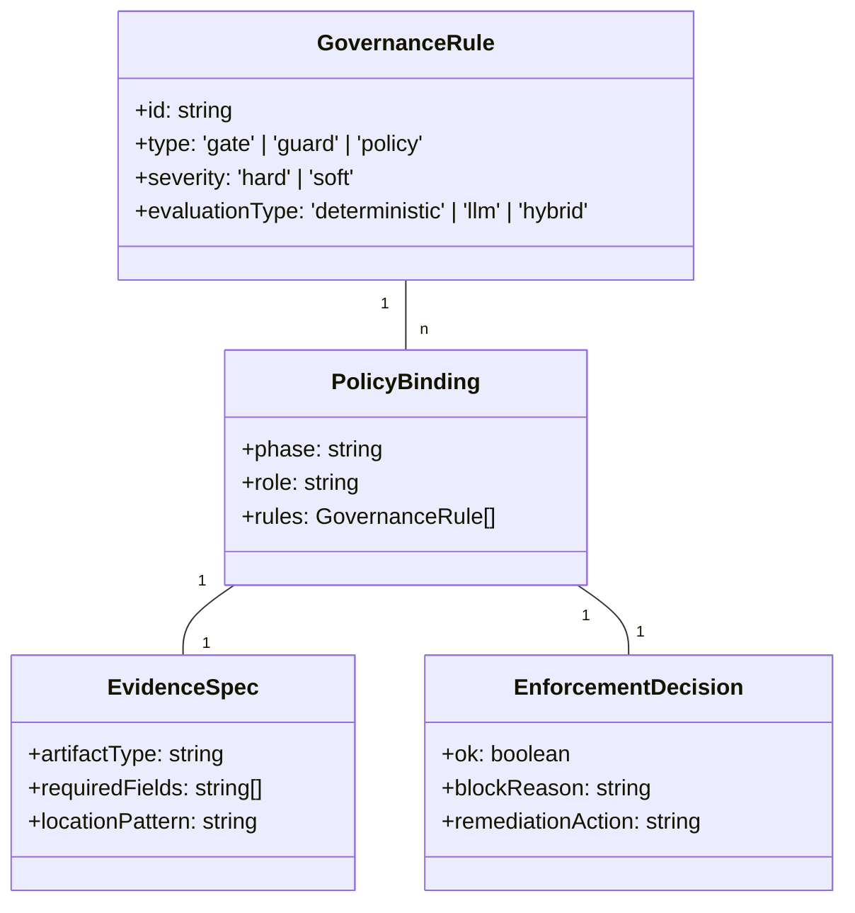

# Governance Layer Discovery & Runtime Policy Audit: Final Report

## Executive Summary

Sprint 6 research confirms that while the **Contractual Layer** (documented in `pm-orchestrator.md` and pipelines) is highly sophisticated, the **Runtime Implementation** is currently a "hybrid" state. 

- **Core Guards are Real**: Git mutation blocks, Preflight tokens, and Workbench tool leasing are fully implemented and enforced in the runtime.
- **Telemetry is Reliable**: Event correlation (runId, ticketId, role, stage) is consistent across ledgers and skill telemetry.
- **Tooling Gap**: A significant portion of mandatory PM automation scripts (`scripts/pm/`, `scripts/plane/`) is missing from the repository.

## 1. Governance Primitives & Runtime Evidence

### 1.1 Mutation Guards (`GitExecutionGuard.ts`)
- **Main Branch Lock**: Successfully prevents any `filesystem`, `git`, or `terminal` actions on `main` or `master`.
- **Preflight Tokens**: Runtime requires an approved `.env` token in `docs/process/git/preflights/` matching the current branch and local worktree.

### 1.2 Workbench Scheduler (`AgentWorkbenchScheduler.ts`)
- **Exclusivity**: `filesystem` and `figma` tools require exclusive leases, preventing concurrent mutation conflicts.
- **Queueing**: Agents are automatically queued for exclusive tools, with lease timeouts and releases handled in the execution loop.

### 1.3 Intake Governance (`IntakeClassifier.ts` & `IntakeGovernance.ts`)
- **Classification**: Requests are correctly routed to specialized pipelines based on LLM intent or explicit user directives.
- **Scoring**: A quality score (0-100) is calculated for every request; scores below 60/70 trigger a block and mandatory clarification questions.

## 2. Telemetry & Auditability

### 2.1 Run Ledgers
- Located in `docs/process/runs/ledger/`.
- Format: JSONL.
- **Audit Result**: High consistency in linkage fields (`runId`, `threadId`, `role`, `stage`). Every stage transition is captured.

### 2.2 Skill Telemetry
- Located at `docs/process/skills/telemetry/skill-usage.jsonl`.
- **Audit Result**: Captures token counts and outcomes per skill usage. Successfully links back to the parent ticket and run.

## 3. Recommended Governance Domain Model

To unify the distributed governance logic, we propose the following domain model for future implementation:

## 4. Gap Analysis & Sprint 6 Takeaways

- **[MISSING] PM Automation**: Need to implement or recover `scripts/pm/ticket_brief_gate.sh`, `scripts/plane/pm_daily_audit.sh`, and `scripts/pm/progress_router.sh`.
- **[DECLARED-ONLY] Assumptions Review**: The "Mandatory assumptions review gate" currently lacks an automated runtime check or artifact generator.
- **[PARTIAL] Postflight binding**: Postflight evidence is written but not yet strictly validated by a hard gate in `DynamicPipelineExecutor` before ticket closure can occur.

---
**Verdict**: The governance foundation is strong (guards/telemetry), but the administrative "middle-ware" (scripts/artifact gates) requires implementation effort in future sprints.
