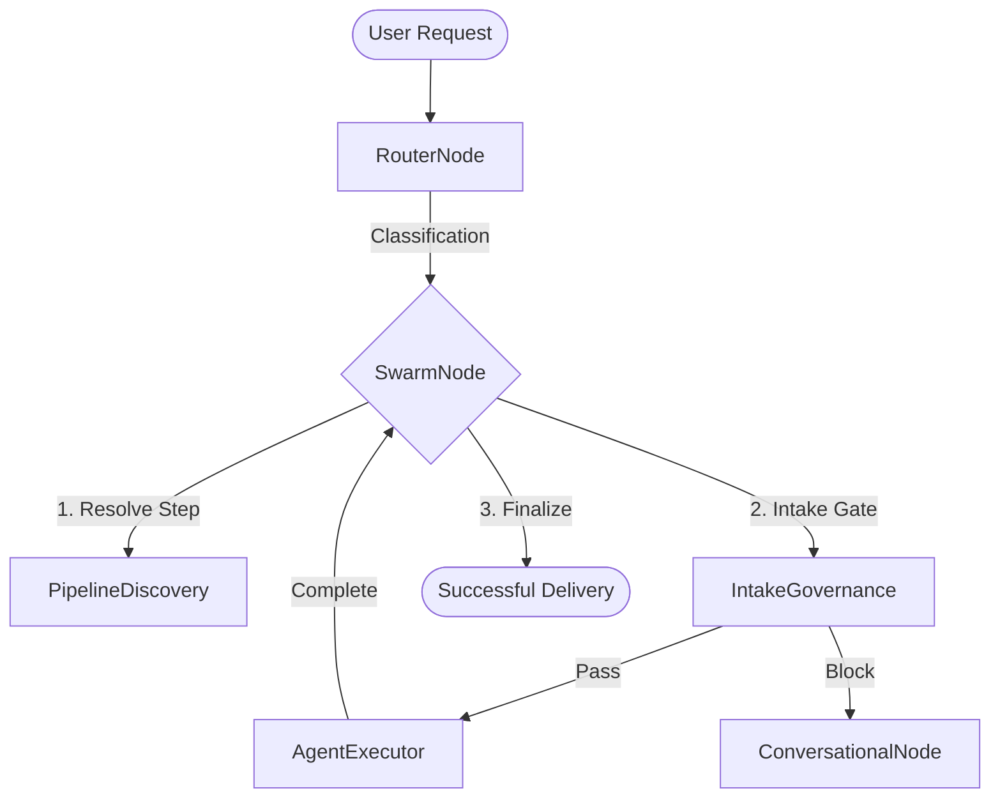

# Current System Architecture: Dynamic Swarm (AGSYS-220)

## 1. Overview
The Agentic Runtime has been transitioned from a hardcoded, static LangGraph topology to a **Declarative Swarm Architecture**. Execution logic is no longer compiled into the graph as fixed nodes; instead, the runtime dynamically interprets pipeline manifests and agent definitions at execution time.

## 2. Core Components

### 2.1. Dynamic Orchestrator (`swarmNode`)
- **Location**: `src/runtime/graphs/PilotQuasiLinearGraph.ts`
- **Role**: A single, recursive LangGraph node that acts as the execution engine for all pipeline stages.
- **Mechanism**:
    1.  Uses `PipelineDiscovery.ts` to load the active pipeline (e.g., `new-feature.md`).
    2.  Infers the next required stage based on the current `state.status`.
    3.  Dynamically map the role name to an agent slug (e.g., "Research Agent" -> `research-agent`).
    4.  Invokes the agent via `AgentExecutor.ts`.

### 2.2. Pipeline Discovery
- **Location**: `docs/pipelines/`
- **Format**: Markdown files define the sequence of roles and their responsibilities.
- **Benefit**: Changing the workflow (e.g., adding a "Security Audit" stage) now only requires editing a markdown file, not recompiling the graph.

### 2.3. Semantic Intake Gate
- **Location**: `src/runtime/IntakeGovernance.ts`
- **Logic**: Integrates an LLM-based verification step (GPT-4o) that evaluates the clarity, scope, and acceptance criteria of a user request.
- **Blocking**: If the score is < 70, the swarm is blocked, and the user is prompted for specific clarifications via an "Intake Pack" artifact.

### 2.4. Context Assembly
- **Component**: `AgentExecutor.ts`
- **Enrichment**: Before calling an external provider (Claude/OpenHands), the system injects:
    - **Artifact Logs**: The full history of decisions and findings from previous agents in the swarm.
    - **Run Metadata**: Plane ticket IDs, Thread IDs, and Pipeline IDs.
    - **System Instructions**: The agent's core instructions are injected as high-priority system prompts.

## 3. Data Flow

## 4. Design Improvements
- **Decoupling**: Graph structure is independent of agent roles.
- **Scalability**: New agents can be registered by adding their `.md` description to `docs/agents/`.
- **Traceability**: All agent interactions are logged in `state.artifactLogs` and propagated to subsequent participants.
