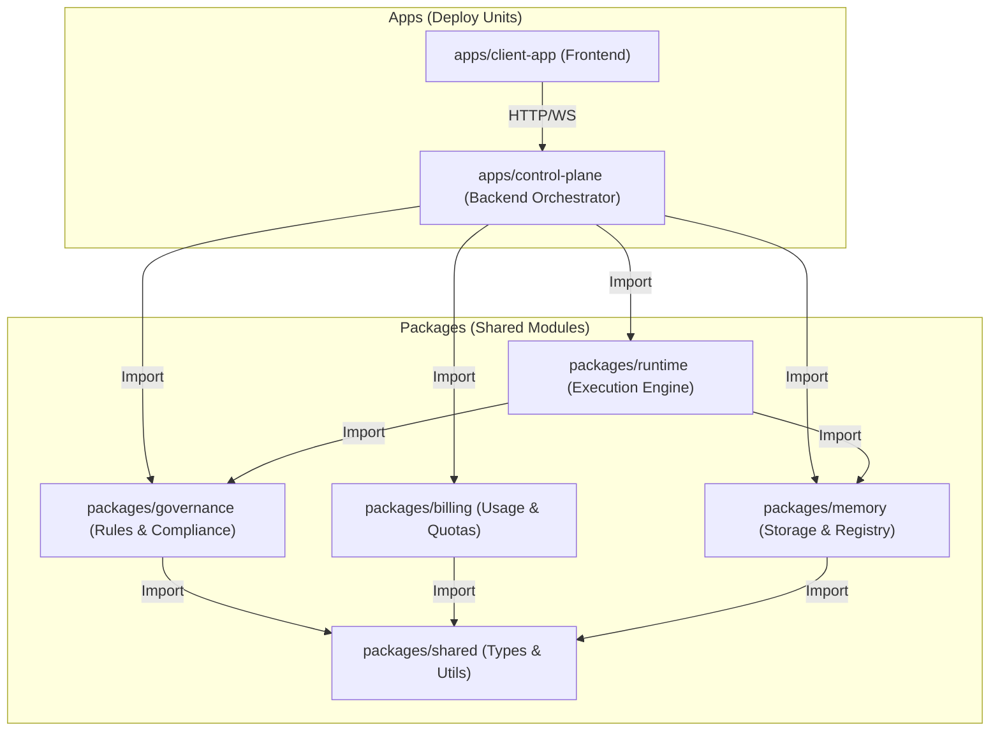

# Design: AGSYS-3701 Topology Schema

This document defines the physical and logical reorganization of the repository to support multi-package monorepo architecture.

## Target Structure

## Module Definitions

| Zone | Folder | Responsibility |
|---|---|---|
| **App** | `apps/client-app` | React/Vite Frontend (Cockpit UI). |
| **App** | `apps/control-plane` | Main API server, Service Registry, and Orchestration. |
| **Package** | `packages/runtime` | Agentic Graph, Tool Loop, and Execution Pipelines. |
| **Package** | `packages/governance` | Validation, Compliance Guards, and Approval Policies. |
| **Package** | `packages/billing` | Cost calculation, Quotas, and Usage auditing. |
| **Package** | `packages/memory` | Database abstractions, Redis counters, and Object Storage. |
| **Package** | `packages/shared` | Common TypeScript interfaces, Constants, and Logger utils. |

## Migration Path

1.  **Initialization**: Create `apps/` and `packages/` directories.
2.  **Workspaces**: Configure `package.json` to include these paths.
3.  **Frontend Move**: Relocate `frontend/` to `apps/client-app`.
4.  **Shared Extraction**: Extract `src/shared` (to be created) and types to `packages/shared`.
5.  **Domain Extraction**: Move `src/runtime/*` and `src/server/*` into their respective packages based on the map above.
6.  **Refactor**: Update all relative imports to use `@system/*` aliases.

## Success Criteria
- [ ] Physical directory structure matches the schema.
- [ ] No circular dependencies between `packages/*`.
- [ ] `apps/*` can be built using isolated Docker contexts.
