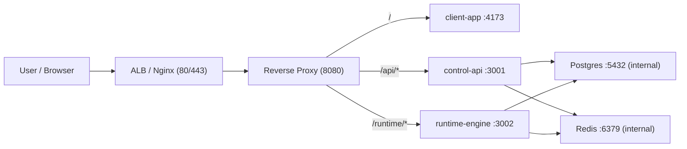

# AGSYS-3820: LB-Ready Endpoint and Port Mapping

## Scope
Reference routing map for Nginx/ALB in front of:
- `client-app`
- `control-api`
- `runtime-engine`

This map is aligned with:
- `infra/compose/runtime.yml`
- `infra/proxy/nginx.reference.conf`

## Port Mapping
- Edge LB / Reverse proxy:
  - `:80` / `:443` public entry (TLS termination)
  - internal forward to proxy listener `:8080` (reference local config)
- Proxy to upstream services:
  - `client-app`: `host.docker.internal:4173`
  - `control-api`: `host.docker.internal:3001`
  - `runtime-engine`: `host.docker.internal:3002`
- Data services (internal-only):
  - Postgres: `:5432`
  - Redis: `:6379`

## Route Map
- `GET /` and SPA routes -> `client-app:4173`
- `GET/POST /api/*` -> `control-api:3001`
- `GET/POST /runtime/*` -> `runtime-engine:3002` with `/runtime` prefix stripped by proxy rewrite

Examples:
- `/api/health` -> `control-api /api/health`
- `/runtime/health` -> `runtime-engine /health`
- `/runtime/ready` -> `runtime-engine /ready`

## Exposure Policy
- Public (internet-facing via LB):
  - `/` (client)
  - `/api/*` (control API)
- Controlled exposure (only via proxy path):
  - `/runtime/*` (runtime engine)
- Internal-only, never internet-facing:
  - Postgres `:5432`
  - Redis `:6379`
  - direct upstream service ports (`:4173`, `:3001`, `:3002`) in production deployment

Policy intent:
- Runtime plane should not be directly reachable from the internet.
- Access to runtime should be mediated by LB/proxy policy and auth controls in control domain.

## Reference Topology Diagram

## Verification Links
- Proxy configuration: `infra/proxy/nginx.reference.conf`
- Proxy smoke script: `scripts/infra/smoke_proxy_paths.sh`
- Proxy smoke command: `npm run infra:smoke:proxy`
