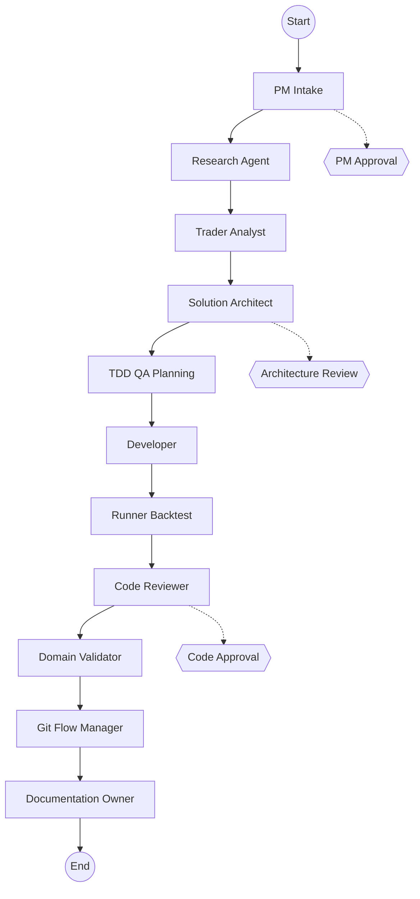

# TKT-54: PilotGraph Expansion (11-Node Multi-Agent Orchestration)

## Design Objective
Transform the `PilotQuasiLinearGraph` into a full-scale industrial pipeline that reflects the 11-role cognitive loop defined in `AGENTS.md`.

## Proposed Architecture (Mermaid)

## State Management Changes
The `PilotState` will be expanded to include:
- `current_role`: Enum of all 11 roles.
- `handoff_metadata`: Object containing specific artifacts per role (e.g., `design_uri`, `test_report_uri`).
- `approvals`: Map of role-based sign-offs.

## Node Transitions
- **Linear Default**: Each node calls the next role's `executor.runRole()`.
- **Conditional Failures**: 
    - If `Review` fails -> Go back to `Dev`.
    - If `QA` fails -> Go back to `Architect`.

## Implementation Strategy
1. **Refactor `PilotStateAnnotation`**: Add typed fields for all 11 roles.
2. **Implement Node Placeholders**: Create 11 async functions that emit events to the Redis bus for UI updates in the Cockpit.
3. **Set Interrupt Points**: Use LangGraph `compile({ interruptBefore: [...] })` for PM and Reviewer gates.
