# AGSYS-243 — Runtime Architecture Audit Brief

Date: 2026-03-28  
Scope: Research only (no implementation)

## 1) Executive Summary
The current Cockpit runtime path is backend-centric and routes chat execution through `/api/chat`, then `executeRuntimeRun`, then a unified graph engine (`PilotQuasiLinearGraph`) for both `linear` and `multiple_agents` modes. UI live updates are delivered via `/api/events/stream` SSE polling from EventBus. Persisted cockpit state (projects/chains/messages/settings/runtime state) is stored in SQLite (`.agent-system/cockpit-runtime.db`).

A key confirmed behavior: `multiple_agents` and `linear` currently share the same execution engine (`pilot-unified-graph`), while only `mock` is separate.

## 2) Confirmed End-to-End Flow (as implemented)

```mermaid
flowchart LR
  U["Cockpit UI"] --> A["POST /api/chat"]
  A --> B["executeRuntimeRun(initialState)"]
  B -->|mock| C["buildMockFinalState"]
  B -->|linear,multiple_agents| D["executeQuasiLinearRun"]
  D --> E["routerNode classifyRequest"]
  E --> F["swarmNode"]
  F --> G["RunContextAssembler"]
  G --> H["AgentExecutor.run"]
  H --> I["contract guard + optional reprompt"]
  I --> J["swarm_stage_completed event"]
  J --> K["finalizeNode -> completed"]
  K --> L["HTTP /api/chat response"]

  M["GET /api/events/stream"] --> N["fetchRecentEvents poll"]
  N --> U
```

## 3) Component Map and Responsibility Zones

1. UI layer
- Cockpit page submits user prompt to `/api/chat` and subscribes to SSE stream at `/api/events/stream`.
- Main orchestration UI source: `frontend/src/components/cockpit/CockpitPage.tsx`.

2. API/backend orchestration entry
- `src/server/agentSystemBackend.ts` handles:
  - request normalization,
  - thread/project message persistence,
  - runtime dispatch,
  - final response shaping,
  - SSE event streaming.

3. Runtime dispatcher
- `src/runtime/graphs/RuntimeExecutionRouter.ts` selects execution engine:
  - `mock` -> mock final state,
  - `linear` + `multiple_agents` -> `executeQuasiLinearRun`.

4. Graph engine
- `src/runtime/graphs/PilotQuasiLinearGraph.ts`:
  - `routerNode`: classifies intent/pipeline,
  - `swarmNode`: resolves next stage + executes agent,
  - contract guard/reprompt,
  - emits stage events,
  - finalize stage.

5. Context and execution
- `RunContextAssembler` builds execution context.
- `AgentExecutor` executes provider call path.

6. Event layer
- EventBus is used for stage/run events.
- SSE endpoint polls recent events and streams to UI.

7. Persistence layer
- SQLite DB `.agent-system/cockpit-runtime.db` stores:
  - `cockpit_projects`,
  - `cockpit_threads`,
  - `cockpit_messages`,
  - `cockpit_settings`,
  - `cockpit_state`.

## 4) Evidence (code anchors)
- Chat runtime entry: `src/server/agentSystemBackend.ts:1279-1379`
- Final message shaping + observability payload: `src/server/agentSystemBackend.ts:1312-1368`
- SSE endpoint + EventBus polling: `src/server/agentSystemBackend.ts:1394-1425`
- Runtime DB schema and restore/persist paths: `src/server/agentSystemBackend.ts:160-347`
- Runtime mode routing: `src/runtime/graphs/RuntimeExecutionRouter.ts:44-64`
- Router classification in graph: `src/runtime/graphs/PilotQuasiLinearGraph.ts:278-329`
- PM-entry enforcement + stage resolution: `src/runtime/graphs/PilotQuasiLinearGraph.ts:440-470`
- RunContext + AgentExecutor path: `src/runtime/graphs/PilotQuasiLinearGraph.ts:492-541`
- Contract guard + reprompt loop: `src/runtime/graphs/PilotQuasiLinearGraph.ts:567-654`
- Finalize and run completion: `src/runtime/graphs/PilotQuasiLinearGraph.ts:737-760`

## 5) Confirmed vs Assumed

Confirmed
- `multiple_agents` and `linear` currently execute the same graph engine.
- PM-entry is force-inserted for first stage when no completed stage exists.
- Contract guard may trigger one auto-reprompt before default formatting.
- UI receives both `/api/chat` payload and SSE event stream updates.
- Cockpit runtime state is persisted in SQLite, with legacy JSON migration paths.

Assumed (to verify in next tasks)
- Actual provider-executor branch behavior under each provider (Codex/OpenHands) per stage.
- Whether "multiple_agents" yields true parallel execution in practice, not only stage-by-stage sequencing.
- Exact coupling between SSE cadence and UI duplicate/ordering artifacts.

## 6) Open Questions for Follow-up Tasks
- Where exactly message duplication happens when both `/api/chat` final response and SSE artifacts are rendered?
- Which events are authoritative for user-visible chat vs runtime diagnostics?
- Should final user message be sourced from stage output, artifact logs, or explicit normalized assistant payload only?

## 7) Stop Condition
This artifact is research-only. No refactor/fix was performed in this task.
