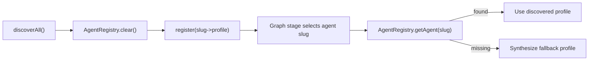

# AGSYS-247 — Dynamic Agent Lifecycle Audit

Date: 2026-03-28  
Scope: Research only (no implementation)

## 1) Lifecycle model (observed)

### Identity key
- Agent identity in runtime is keyed by `slug` in `AgentRegistry` map.
- Evidence: `src/runtime/registries/AgentRegistry.ts:17-30`

### Creation path
- On discovery, agent profiles are rebuilt from manifest-linked files (or docs fallback) and re-registered.
- Discovery calls `AgentRegistry.clear()` then registers all agents again.
- Evidence: `src/runtime/DynamicDiscoveryService.ts:15-24`, `40-42`, `80-82`, `114-115`

### Runtime usage path
- Graph resolves stage agent slug, then resolves profile from `AgentRegistry`; fallback profile synthesized if missing.
- Evidence: `src/runtime/graphs/PilotQuasiLinearGraph.ts:499-516`

## 2) When agent is "same" vs "new"
- "Same" at runtime means same `slug` currently present in the static registry map.
- "New" occurs when discovery re-runs and map is rebuilt (even same slugs are re-instantiated profiles).

## 3) Trigger points related to project/chat actions

### New chat creation
- Chat creation updates `threadStore`/`threadMessageStore` and project runtime context.
- Does not directly create per-thread agent registry copies.
- Evidence:
  - create chain endpoint: `src/server/agentSystemBackend.ts:949-1014`
  - UI create flow: `frontend/src/components/cockpit/CockpitPage.tsx:1111-1151`, `1299-1316`

### Project deletion
- Deleting project removes project/thread/messages/binding from backend stores.
- No explicit per-project agent registry teardown exists (registry is global).
- Evidence: `src/server/agentSystemBackend.ts:1060-1079`

### Project re-add
- Re-adding project creates project entry and chains, then syncs plane binding.
- Agent registry still sourced globally from discovery.

## 4) Risks (identity/persistence/reuse)
1. Global registry reuse:
- Agent definitions are process-global, not project-scoped instances.

2. Discovery replacement drift:
- Re-discovery can replace runtime profiles while other threads are active.

3. Fallback profile path:
- If registry miss occurs, synthesized fallback agent profile is used, which can hide catalog drift.

## 5) Entity lifecycle diagram

## 6) Confirmed vs assumed

Confirmed
- Agent identity key is `slug`.
- Registry is global static map rebuilt by discovery.

Assumed
- Need runtime stress test to quantify impact of mid-run discovery refresh.

## 7) Stop condition
Research artifact only. No lifecycle refactor implemented.
