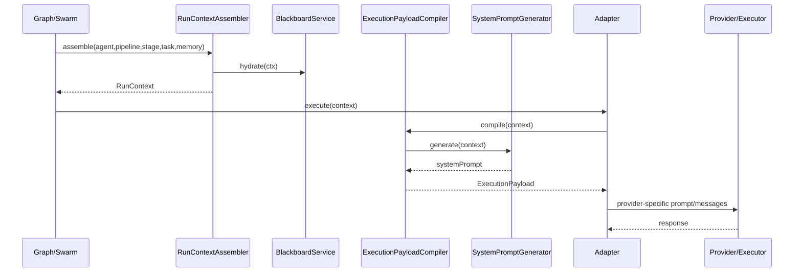

# AGSYS-248 — Prompt Assembly Audit Brief

Date: 2026-03-28  
Scope: Research only (no implementation)

## 1) How prompt is assembled (confirmed)

1. `RunContextAssembler.assemble(...)` builds canonical `RunContext` (agent/pipeline/task/memory/tools/guardrails).
- Evidence: `src/runtime/context/RunContext.ts:117-217`

2. `ExecutionPayloadCompiler.compile(context)` transforms `RunContext` into provider-agnostic `ExecutionPayload`.
- Includes:
  - `systemPrompt` from `SystemPromptGenerator.generate(context)`
  - `userPrompt` from `context.task.rawUserInput`
  - memory (`facts`, `decisions`, `threadHistory`)
  - tools schema list
- Evidence: `src/runtime/context/ExecutionPayloadCompiler.ts:42-73`

3. Adapter layer converts payload into provider-specific request:
- LangChain adapter creates messages:
  - `SystemMessage(systemPrompt)`
  - mapped `threadHistory`
  - final `HumanMessage(userPrompt)`
- Evidence: `src/runtime/adapters/LangChainAdapter.ts:25-41`

4. OpenHands adapter composes a single prompt string:
- concatenates `systemPrompt` + `USER REQUEST:` + `userPrompt`
- passes to external executor.
- Evidence: `src/runtime/adapters/OpenHandsAdapter.ts:18-31`

## 2) Input sources to final prompt mapping

| Input source | Where enters context | Where appears in final prompt |
|---|---|---|
| Agent instructions/callsign/mission | RunContext `agent` | `SystemPromptGenerator` role/instructions section |
| Pipeline + stage | RunContext `pipeline` | `SystemPromptGenerator` pipeline section |
| Ticket/context metadata | RunContext `activeTicketId` | `SystemPromptGenerator` ticket section |
| Shared facts/decisions | Blackboard hydrate -> `context.memory` | `SystemPromptGenerator` facts + payload memory |
| Thread history | `context.memory.threadHistory` | Adapter message list / payload memory |
| Tools | ToolDiscovery -> `context.tools` | `SystemPromptGenerator` + adapter tool bindings |
| User request | task raw input | `userPrompt` / final human message |

## 3) LangGraph/LangChain influence
- Graph decides stage + agent and builds RunContext each stage.
- LangChain adapter handles model invocation and (optional) tool binding.
- Thus, orchestration affects prompt content before provider call.

## 4) Confirmed gaps
1. No first-class persisted prompt trace object yet (assembled prompt not stored as dedicated artifact by default).
2. Provider-specific prompt serialization differs (message list vs single string prompt).

## 5) Prompt generation sequence diagram

## 6) Stop condition
Research artifact only. No prompt pipeline refactor implemented.
