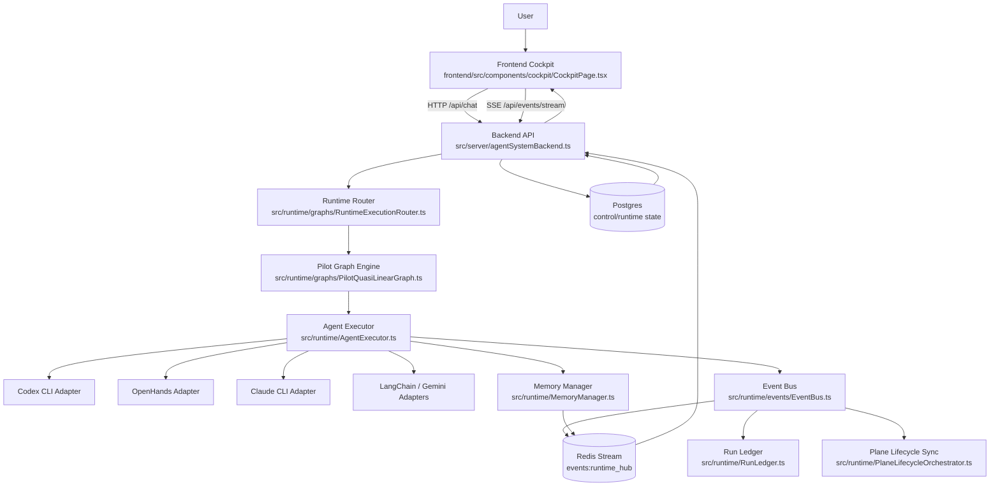

# Runtime Architecture Diagram (AGSYS-294)

## Purpose

This artifact defines the end-to-end runtime path used by Agent Cockpit:

`UI -> API -> Runtime Orchestrator -> Agent/Provider Execution -> Event Bus -> Storage -> UI`

It is a reference contract for Sprint 0.5 (`PM-S0.5-1`).

## End-to-End Diagram

## Contracted Component Boundaries

1. Frontend does not directly execute agents or providers.
2. Backend API is the control plane for runtime start/cancel/state access.
3. `RuntimeExecutionRouter` is the single mode dispatcher (`mock`, `linear`, `multiple_agents`).
4. `AgentExecutor` is the provider abstraction boundary.
5. Event stream is authoritative for runtime progression (`EventBus` + Redis stream).
6. Persistent cockpit/runtime state is Postgres-first; Redis is the runtime stream/memory backbone.

## Primary Source Files

- `src/server/agentSystemBackend.ts`
- `src/runtime/graphs/RuntimeExecutionRouter.ts`
- `src/runtime/AgentExecutor.ts`
- `src/runtime/events/EventBus.ts`
- `src/runtime/MemoryManager.ts`
- `src/runtime/redisClient.ts`
- `frontend/src/components/cockpit/CockpitPage.tsx`

## Acceptance Mapping (`PM-S0.5-1`)

- `diagram exists` -> this file (`architecture.md`) contains a complete mermaid diagram.
- `covers all components` -> includes UI/API/runtime/agents/providers/events/storage.
- `used as reference` -> path is stable under `docs/runtime/` for downstream sprint tickets.
