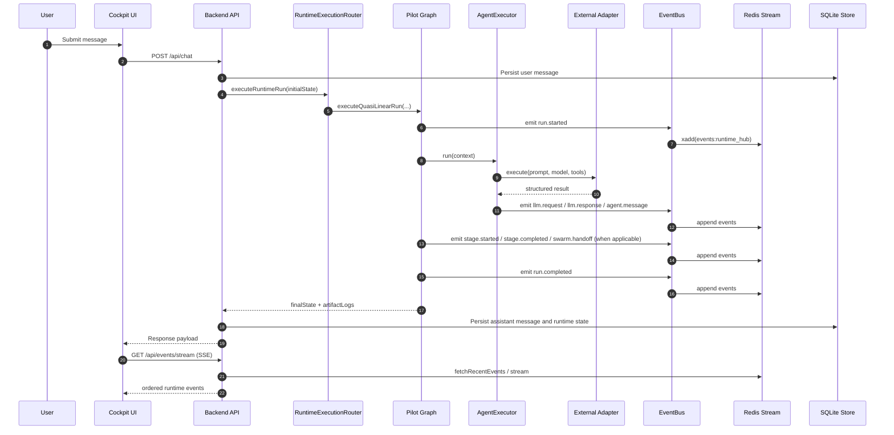

# Runtime Sequence Flow (AGSYS-295)

## Purpose

This document defines the ordered lifecycle of a single runtime run from user input to completion and UI projection.

It is the sequence contract artifact for Sprint 0.5 (`PM-S0.5-2`).

## Sequence Diagram

## Lifecycle Guarantees

1. A run starts with a new user input and has its own `runId`.
2. Core event emissions are ordered and timestamped.
3. Agent/provider execution is wrapped behind `AgentExecutor`.
4. Final UI state is a projection of persisted messages and runtime events.

## Source Files

- `src/server/agentSystemBackend.ts`
- `src/runtime/graphs/RuntimeExecutionRouter.ts`
- `src/runtime/graphs/PilotQuasiLinearGraph.ts`
- `src/runtime/AgentExecutor.ts`
- `src/runtime/ExternalExecutionAdapter.ts`
- `src/runtime/events/EventBus.ts`
