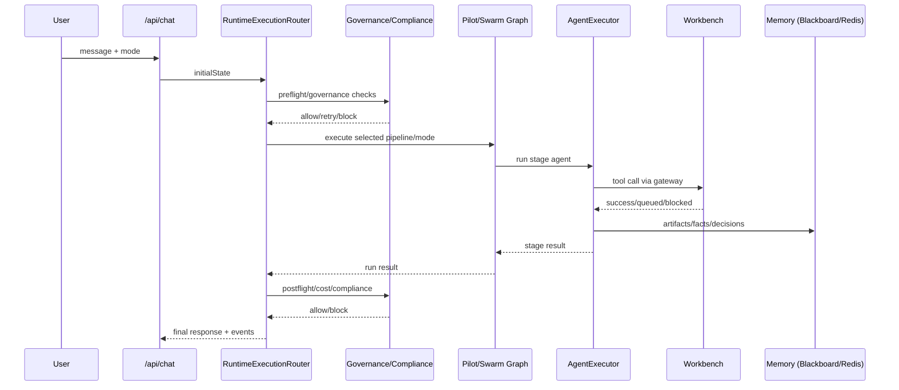

# System Capability Audit Report (Pre-Sprint 22/23 Gate)

Generated: 2026-04-08  
Branch: `codex/s19-runtime-remediation`  
Commit: `0a2c8fa`

## 1. Capability Overview Table

| Capability | Exists | Layer | Implementation Type | Source | Stable | Notes |
|---|---|---|---|---|---|---|
| 1. Self-Improvement Loop | ✅ | Runtime router + improvement engine | Hybrid (deterministic + generated artifacts) | `src/runtime/graphs/RuntimeExecutionRouter.ts`, `src/runtime/improvement/ImprovementEngine.ts`, `src/runtime/SelfImprovementLoop.ts` | ⚠️ | Генерує сигнали/артефакти; автоприйняття змін обмежене. |
| 2. Auto Retry | ✅ | Provider + queue + governance + guardrails | Imperative | `OpenHandsExecutionProvider.ts`, `ProjectDispatchQueue.ts`, `GovernanceEngineCore.ts`, `Guardrails.ts` | ⚠️ | Retry багаторівневий, але policy фрагментована. |
| 3. Smart Routing | ✅ | Runtime router + intake classifier | Hybrid | `RuntimeExecutionRouter.ts`, `PilotQuasiLinearGraph.ts`, `IntakeClassifier.ts` | ⚠️ | Є enforcement, але routing частково LLM-залежний. |
| 4. Loop Enforcement | ✅ | Governance/compliance/cost phases | Deterministic-first | `RuntimeExecutionRouter.ts`, `GovernanceEngineCore.ts`, `ComplianceEnforcementLoop.ts` | ⚠️ | Enforcement є, але кінцевий контроль якості не всюди hard-gated. |
| 5. Workbench | ✅ | Workbench gateway/scheduler | Imperative | `WorkbenchGateway.ts`, `AgentWorkbenchScheduler.ts` | ✅ | Є queue, policy modes, lock semantics. |
| 6. Tool Usage Tracking | ✅ | Telemetry | Imperative | `WorkbenchTelemetryCollector.ts`, `SkillTelemetryRegistry.ts` | ✅ | Пише JSONL-телеметрію, читається governance/compliance. |
| 7. Pre/Post Flight | ✅ | Governance + enforcers | Hybrid | `PreflightEnforcer.ts`, `PostflightEnforcer.ts`, `GovernanceEngineCore.ts` | ⚠️ | Реалізовано, але залежить від коректності артефактів/заповнення. |
| 8. Declarative Rules Engine | ✅ | Governance rule registry | Hybrid | `RuleRegistry.ts`, `docs/runtime/governance/rule-registry.yaml`, `DeterministicEvaluationEngine.ts` | ✅ | YAML читається реально, є deterministic checks. |
| 9. Memory Isolation | ✅ | Worker/runtime/memory | Hybrid | `DynamicWorkerSpawnManager.ts`, `MemoryManager.ts`, `BlackboardService.ts` | ⚠️ | Є namespaces per project/agent; треба періодичний leakage audit. |
| 10. Agent Memory | ✅ | Redis-backed memory + run context | Hybrid | `MemoryManager.ts`, `BlackboardService.ts`, `RunContext.ts` | ⚠️ | Persistent memory є; поведінка reset/retention залежить від ключів/TTL. |
| 11. Multiple Agents Mode | ⚠️ | Runtime orchestration | Hybrid simulation | `RuntimeExecutionRouter.ts`, `MultipleAgentsRuntime.ts`, `PilotQuasiLinearGraph.ts` | ⚠️ | Є multi-agent flow і subprocess execution, але не Kubernetes/Ray-grade distributed control plane. |
| 12. Worker Model | ✅ | Worker manager + queue + health | Imperative | `DynamicWorkerSpawnManager.ts`, `ProjectDispatchQueue.ts`, `agentSystemBackend.ts` | ✅ | Worker lifecycle/control добре покриті Sprint 21. |
| 13. Token Tracking | ✅ | LLM/event/cost layers | Imperative | `llm/LLMWrapper.ts`, `CostOptimizationEngine.ts`, `RuntimeExecutionRouter.ts` | ⚠️ | Трекинг є, accuracy залежить від provider usage payloads. |
| 14. Agent Usage Metrics | ✅ | Skill telemetry + governance telemetry reader | Imperative | `SkillTelemetryRegistry.ts`, `governance/TelemetryReader.ts` | ✅ | Метрики читаються і використовуються в checks. |
| 15. Dynamic Skill Selection | ⚠️ | Router + runtime manifests | Hybrid | `RuntimeExecutionRouter.ts`, `PilotQuasiLinearGraph.ts` | ⚠️ | Є requested/enforced skills, але selection не повністю адаптивний planner. |
| 16. Adaptive Pipelines | ⚠️ | Intake + runtime router | Hybrid | `IntakeClassifier.ts`, `RuntimeExecutionRouter.ts` | ⚠️ | Є adaptive policy/cost gates, але не повний self-rewriting pipeline planner. |
| 17. Self-Healing | ⚠️ | Improvement + governance | Hybrid | `ImprovementEngine.ts`, `GovernanceEngineCore.ts` | ⚠️ | Переважно через tickets/artifacts; auto code-heal обмежений. |
| 18. Agent Performance Scoring | ⚠️ | Telemetry summaries | Imperative-lite | `SkillTelemetryRegistry.ts`, `CostOptimizationEngine.ts` | ⚠️ | Є usage/latency/tokens, але явної unified score model ще нема. |

## 2. Capability Details

### 2.1 Self-Improvement Loop
- Exists: ✅
- Where: `RuntimeExecutionRouter` запускає сигналізацію/артефакти (`generateImprovementSignals`, `writeImprovementArtifacts`), також є `SelfImprovementLoop.ts`.
- Layer: Runtime orchestration + improvement engine.
- Type: Hybrid.
- Trigger: Після виконання run, через governance/cost сигналізацію.
- Artifacts: proposals, traceability, governance notes, tickets.
- Deterministic: Частково (signal generation deterministic, content proposals може бути LLM-assisted).
- Issues: Немає гарантованого fully-automatic safe apply для всіх сценаріїв.

### 2.2 Auto Retry
- Exists: ✅
- Retry domains: provider/network (`OpenHandsExecutionProvider`), queue retry (`ProjectDispatchQueue.retryTask`), governance soft retry (`GovernanceEngineCore`), guard retry counters (`Guardrails`).
- Deterministic: Так на рівні counters/policies.
- Issues: Retry policy розподілена між модулями, потрібна уніфікація policy contract.

### 2.3 Smart Routing
- Exists: ✅
- Where: `RuntimeExecutionRouter`, `PilotQuasiLinearGraph`, `IntakeClassifier`.
- Type: Hybrid.
- Deterministic enforcement: Є (`enforcedPipeline`, `enforcedSkills`), mismatch блокується.
- Issues: Initial routing still depends on classifier confidence/LLM default patterns.

### 2.4 Loop Enforcement
- Exists: ✅
- Where: compliance + governance + cost phases in `RuntimeExecutionRouter`.
- Deterministic: Так (block/retry/deviation logic).
- Issues: Частина loop semantics покладається на policy tuning, не на formal proof.

### 2.5 Workbench / Tools
- Exists: ✅
- Where: `WorkbenchGateway`, `AgentWorkbenchScheduler`, `ToolExecutor`.
- Features: isolation modes (`isolated`, `share-safe`, `exclusive`), queueing, lock ownership, blocked direct access.
- Stable: ✅

### 2.6 Tool Usage Tracking
- Exists: ✅
- Where: `WorkbenchTelemetryCollector`, `SkillTelemetryRegistry`, event bus.
- Artifacts: JSONL telemetry files.
- Stable: ✅

### 2.7 Pre/Post Flight
- Exists: ✅
- Where: `PreflightEnforcer`, `PostflightEnforcer`, `GovernanceEngineCore`.
- Type: Hybrid (rule-based + evidence collection).
- Stable: ⚠️ (operational quality depends on artifact discipline).

### 2.8 Declarative Rules Engine
- Exists: ✅
- Where: `RuleRegistry` loads YAML (`docs/runtime/governance/rule-registry.yaml`), `DeterministicEvaluationEngine` executes checks.
- Type: Hybrid (declarative registry + imperative evaluators).
- Stable: ✅

### 2.9 Memory Isolation
- Exists: ✅
- Where: `MemoryManager` namespace by `projectId + role`, worker isolation in `DynamicWorkerSpawnManager`, run/chain scoping in `BlackboardService`.
- Stable: ⚠️ (needs periodic leakage verification in long runs).

### 2.10 Agent Memory
- Exists: ✅
- Short-term + long-term records: Redis-backed keys.
- Shared memory/facts: via Blackboard (`shared` scopes).
- Stable: ⚠️ TTL/cleanup policies need continuous hygiene.

### 2.11 Multiple Agents Mode
- Exists: ⚠️
- Where: `RuntimeExecutionRouter` -> `executeMultipleAgentsRun`, `PilotQuasiLinearGraph`, `WorkerProcessExecutor`.
- Fact: Є multi-agent orchestration і subprocess execution path.
- Gap: Це ще не повністю distributed control plane рівня Kubernetes/Ray (інфра orchestration layer не еквівалентний cluster scheduler).

### 2.12 Worker Model
- Exists: ✅
- Where: `DynamicWorkerSpawnManager`, queue + backend control endpoints.
- Includes: pause/resume/restart/kill, bulk/project controls, health snapshots, project pause.
- Stable: ✅

### 2.13 Token Tracking
- Exists: ✅
- Where: `LLMWrapper` emits `llm.response` token payloads; `CostOptimizationEngine` aggregates.
- Stable: ⚠️ depends on provider response metadata consistency.

### 2.14 Agent Usage Metrics
- Exists: ✅
- Where: `SkillTelemetryRegistry`, `TelemetryReader`, governance checks.
- Stable: ✅

### 2.15 Dynamic Skill Selection
- Exists: ⚠️
- Where: runtime supports requested/enforced skills and compliance checks.
- Gap: Немає fully autonomous dynamic planner, який на кожному кроці оптимально перебудовує skill set із доказом оптимальності.

### 2.16 Adaptive Pipelines
- Exists: ⚠️
- Where: `IntakeClassifier` + `RuntimeExecutionRouter` adaptive/cost policy.
- Gap: Адаптація є, але не full adaptive pipeline synthesis engine.

### 2.17 Self-Healing
- Exists: ⚠️
- Where: improvement signals + governance escalation + artifact generation.
- Gap: System mostly produces remediation tasks/artifacts; limited automatic verified code self-healing.

### 2.18 Agent Performance Scoring
- Exists: ⚠️
- Current state: telemetry dimensions (tokens, retries, usage) exist.
- Gap: unified scoring model/KPI contract per agent not finalized.

## 3. Sequence Diagram

## 4. Layer Map

- LLM Prompt Layer:
  - `SystemPromptGenerator`, role prompts, output contract guard.
- Orchestration Layer:
  - `RuntimeExecutionRouter`, `PilotQuasiLinearGraph`, `UnifiedSwarmGraph`, `MultipleAgentsRuntime`.
- Governance/Compliance Layer:
  - `GovernanceEngineCore`, `DeterministicEvaluationEngine`, pre/postflight enforcers, rule registry YAML.
- Runtime Worker/Queue Layer:
  - `DynamicWorkerSpawnManager`, `ProjectDispatchQueue`, worker controls in backend.
- Tool/Workbench Layer:
  - `WorkbenchGateway`, `AgentWorkbenchScheduler`, `ToolExecutor`.
- Memory Layer:
  - `BlackboardService`, `MemoryManager`, run context memory.
- Telemetry/Cost Layer:
  - `EventBus`, `LLMWrapper`, `SkillTelemetryRegistry`, `WorkbenchTelemetryCollector`, `CostOptimizationEngine`.
- Backend/UI Control Plane Layer:
  - `agentSystemBackend.ts`, cockpit UI control actions + SSE stream.

## 5. Deterministic vs LLM Responsibility

Deterministic enforcement (strong):
- Governance rule loading/evaluation pipeline.
- Required pipeline/skill enforcement blocks.
- Worker/task control actions and queue operations.
- Cost/token threshold checks and run cancellation paths.

LLM-responsible / probabilistic zones:
- Intent classification confidence paths.
- Content quality of generated analysis/proposals.
- Some routing behavior when explicit constraints are absent.

## 6. Critical Gaps Before Sprint 22/23

1. Multiple-agents runtime still not equivalent to full distributed cluster orchestration.
2. Adaptive skill/pipeline planning is partial, not end-to-end autonomous optimizer.
3. Self-healing is mostly remediation artifact generation, not broad verified auto-fix.
4. Unified agent performance scoring contract is incomplete.

## 7. Gate Decision

Overall: **PARTIAL READY**

- Ready to start Sprint 22/23: ✅
- Condition: Спринт цілитись на закриття gap-ів #1-#4 вище з чіткими acceptance checks.
- Recommended first sprint target: formalize distributed worker runtime contract + unified performance scoring + adaptive planner boundaries.
